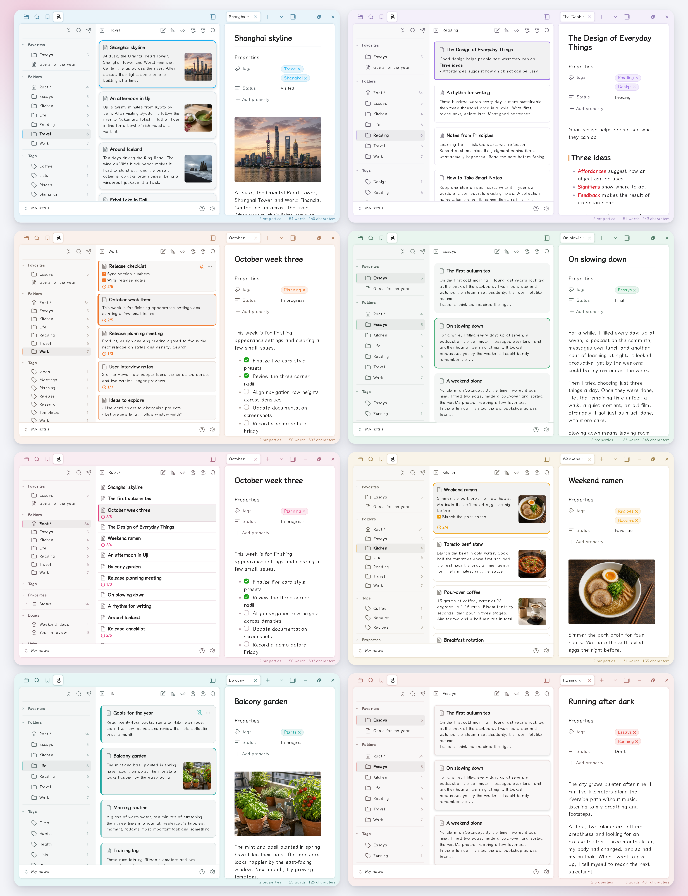

# Card Workspace

[简体中文](README.zh-CN.md)

Card Workspace is an [Obsidian](https://obsidian.md/) plugin for **capturing, gathering, organizing, and reframing notes**. Capture ideas with quick input or templates, then browse folders, tags, properties, outgoing links, backlinks, and card boxes as a readable card stream. On desktop, it sits in the **left sidebar** beside the editor; on phones and tablets, it opens in the main workspace.

Each Markdown card shows a title and a lightweight content preview, so a set of notes stays readable without collapsing into filenames. Click a card to open its note. Card boxes bring notes together while keeping source files in their original folders; drag cards onto navigation items to move files, apply metadata, or add them to a box.

Documentation: [card-workspace](https://kenanlian.github.io/card-workspace/en/).



## Table of contents

- [Why Card Workspace](#why-card-workspace)
- [Installation](#installation)
- [File types](#file-types)
- [Quick start](#quick-start)
- [Features](#features)
- [Compatibility and limitations](#compatibility-and-limitations)
- [Privacy](#privacy)
- [Development](#development)
- [Releasing](#releasing)
- [Support and license](#support-and-license)

## Why Card Workspace

Card Workspace is for people who scan and collect notes while writing: research topics, long-running projects, reading lists, and any body of work that crosses folder boundaries. It gives you direct controls instead of another query language.

- **Capture** — jot down ideas in quick input, create notes with tags and properties, or use templates for recurring notes.
- **Gather** — browse a folder or card box and narrow the stream with tags or frontmatter properties. Include subfolders when useful, or follow a note’s outgoing links and backlinks.
- **Organize** — sort, group, and pin the stream, then save a useful view as a card box.
- **Reframe** — keep that context beside the editor, or drag a Markdown card into the note you are writing.

## Installation

Card Workspace can be installed from Obsidian’s Community Plugins directory. You can also install a specific version manually from GitHub Releases.

### Install from Community Plugins

1. Open **Settings → Community plugins** in Obsidian.
2. Turn off Restricted mode if it is enabled.
3. Select **Browse** and search for **Card Workspace**.
4. Select **Install**, then **Enable**.

The plugin’s [directory page](https://community.obsidian.md/plugins/card-workspace) can also hand installation back to Obsidian.

### Install from GitHub Releases

Use this route when you need a version other than the current Community Plugins release.

1. Download the release from the [Releases](https://github.com/kenanlian/obsidian-card-workspace/releases) page.
2. Extract `main.js`, `manifest.json`, and `styles.css` into your vault’s `.obsidian/plugins/card-workspace/` folder.
3. Open **Settings → Community plugins**.
4. Turn off Restricted mode if needed.
5. Enable **Card Workspace** in the installed plugins list.

## File types

Choose **Documents only**, **Common formats** (default), or **All formats** in settings. Images can display cached thumbnails; non-Markdown files are searchable by title. See [File types / 文件类型](docs/file-types.md).

## Quick start

1. Select the ribbon icon, or run **Open Card Workspace view** from the command palette. The view opens in the **left sidebar** on desktop, or the main workspace on mobile.
2. Use **New note**, choose a template, or select the paper-plane button (**Open quick input**) to capture an idea. Quick input uses independent windows on desktop and a dialog on mobile.
3. Pick a folder or card box in the navigation pane, then narrow it with tags or property values. You can also start from the note you are reading with its outgoing links or backlinks.
4. Browse the card stream. Use search, sorting, grouping, or pins to shape the view, then click a card to open its note.
5. Right-click a navigation item or card for more actions. Drag a Markdown card into an open editor to insert a link or content; on mobile, use the card menu’s insertion and copy actions.

Card Workspace restores the last **folder** you browsed. If it was the vault root, it restores the whole vault. It does not reopen the last card box or linked-note source.

## Features

- **Quick input.** Capture Markdown in independent desktop windows that stay on top by default, with an optional global shortcut for use from other apps. Choose a destination folder, optionally add a title, tags and properties, and send the note to several card boxes. Supported frontmatter uses Obsidian’s native Properties editor. Create a new note or append the body to an existing note; Ctrl/Cmd+Enter sends. Phones and tablets use an Obsidian dialog. See [note creation, templates, and quick input](docs/note-input.md).
- **Note creation and templates.** Create a note in the current folder, inheriting selected tags or supported property filters; notes created in a card box are also added to that box. Keep reusable templates in navigation, each with its own destination folder and date/time formats, including `{{date}}`, `{{time}}`, and inline format overrides. Templates can create a note or insert their body into an existing note.
- **Navigation pane.** A resizable column sits next to the card stream, so folders, tags, properties, card boxes, and favorites are one click away. Drag the divider to resize it, or hide it so the cards use the full width. When the sidebar is too narrow for two columns, the layout falls back to a single pane and the header toggle swaps between navigation and cards.
- **Navigation controls.** Search navigation entries independently of card content. Use the header button to expand or collapse all sections, or expand and collapse folders and tags from their context menus.
- **Hide navigation entries.** Right-click a folder, tag, or section heading to hide it. Open **Settings → Card Workspace → Navigation** to restore sections or manage hidden folders and tags across the vault. Hiding affects navigation only; cards, search, filters, and existing favorites stay available. See [navigation visibility](docs/navigation-visibility.md).
- **Folder and card-box filters.** Choose a folder and include its subfolders when useful, or open a card box, then narrow the stream with tags or frontmatter properties. Ctrl/Cmd-click tags or property values, or choose **Add to filter** from their context menus, to combine browsing filters. Ordinary clicks select one filter type; **Remove from filter** removes just that condition. Switching to a different folder or card box clears both selections; refreshing the current source keeps them. Filtering a box does not change its rules, membership, or member count. Links views pause browsing filters and show a hint. Clear browsing filters without clearing the search query.
- **Card boxes.** Save a folder, tag, and property view as a reusable collection, including its current grouping configuration. Matching notes keep appearing as the vault changes. Add or exclude individual notes by hand, and give each box its own sort, grouping, and pins. Configure a box to change its grouping dimension, property, group order, and direction. Source files stay where they are. A linked-note view can be saved as a fixed snapshot.
- **Linked notes.** Switch between outgoing links and backlinks around the active note. Let the source follow the editor, or pin it while you inspect other notes. Both directions default to reference count, highest first, and remember their sort independently. Each file remains one card with a badge counting references between it and the current note. Backlinks show three reference contexts by default; choose 1, 2, 3, or all in settings, and expand the remaining contexts within a card. Repeated references in one paragraph share a context while retaining their occurrence count. Both directions use the ordinary card Markdown renderer. Outgoing heading and block links show the destination content; plain links show the linked note’s opening content with the ordinary preview line budget. Backlinks show the source reference context. Repeated links to the same destination location share one preview. Click a snippet to open the source reference or destination it displays.
- **Local full-text search.** Search the current folder, card box, outgoing links, or backlinks. Markdown cards show highlighted snippets in source order, using the same lightweight list, read-only task, heading, code, and link cues as ordinary previews, with two display lines per snippet: an independent setting allows up to 1–5 snippets per card (default 2). Overlapping contexts are merged; short hit lines include following prose. Click a snippet or press Enter/Space to locate its hit while keeping the note's editing or reading mode. Each card retains its hit count; title-only matches highlight the title and keep the usual opening preview. Clearing search restores the usual preview. Chinese search uses characters and adjacent character pairs; pinyin is not indexed.
- In **Cards and previews**, enable **Skip leading tags** to omit tag-only lines at the start of a note from its opening card preview. This is off by default; skipped tags use no preview lines or characters. Body text, search matches, and note files are unchanged.
- **Arrange the stream.** Sort by edited time, created time, or filename, and group the cards. Pin notes to keep them at the top. Pins only reorder cards that already match the active filters and search.
- **Drag into the editor.** Drop a Markdown card at the cursor to insert a wikilink, an embed, the note body, or its title and body. Choose each time, or set a default. Turn on **Enable section drag insertion** in Behavior settings to choose a heading section or the whole note. Section content includes its child headings and stops at the next heading of the same or higher level; copying preserves the original Markdown. This option is off by default.
- **Drag into a canvas.** Drag a card into Canvas or Excalidraw as a native Obsidian file. The target decides how to display it and handles modifier keys. Even in bulk mode, a drag contains only the card you started from.
- **Drag to organize.** Drop cards onto a folder to move them, a tag to add it, a property value to set or append it, or a card box to add manual members. Dragging a selected card applies the operation to the visible selection. On touch screens, long press to start dragging; in a single-pane layout, navigation opens as a drop target.
- **Custom content icons.** Click a navigation or card title icon to choose Lucide, a native emoji, or no icon (plain text), or use the context menu. Set category defaults, including no icon, in settings; favorites follow their original objects. Choosing an icon saves it and closes the picker; recently used icons and per-category suggestions come first. The complete bilingual emoji catalogue works offline. See [custom icons / 自定义图标](docs/content-icons.md).
- **Look and density.** In Appearance settings, scale the panel's text (Small, Default, Large, Extra large), choose Compact, Default, or Comfortable spacing, adjust corner radii and preview length, and pick a card style: default cards, a minimal outline, list rows separated by lines, flat color blocks, or a left accent bar. List rows in the same line stay equal height, so separators align across columns. Set a default card background color, or use a card’s **Background color** context menu or the bulk toolbar to apply one of eight theme-adaptive colors. **Follow default** clears individual overrides.
- **Card image previews.** Since 1.3.4, images default to a right thumbnail with Crop to fill. In plugin settings, switch to an image below the title, choose Show whole image, or turn images off. Local PNG, JPEG, WebP, and BMP body embeds load near the viewport. Thumbnails are cached across restarts. See [image previews](docs/card-images.md).
- **Bulk actions.** Click to select individual cards, Shift-click a range, or select the whole view. Then move notes, add or remove tags, change card-box membership, merge Markdown notes with a live preview, or delete the selection.
- **Folder drag and drop.** In the Folders section, drop on the middle half of a row to move the folder into it; drop on the upper or lower quarter to reorder siblings. Changes run immediately on release. Hover for 600ms to expand a collapsed target; drag near the scroll edges to scroll. Root stays first and only accepts moves. Each sibling group gains its own saved manual order after its first effective reorder. New folders append to manual groups. Choose name sorting (A → Z or Z → A) or manual sorting in a separate group in a folder’s menu to sort its direct child folders, or from the Folders section or root row menu to sort top-level folders. A → Z clears that group's manual order and restores default name sorting; Z → A saves the current descending order, with new folders appended afterward. The menu checks the active choice. Selecting manual sorting keeps the current order; a valid reorder drop automatically selects manual sorting. Name conflicts are rejected without merging or overwriting. Folder and favorite dragging stay within their own sections.
- **Tag and property navigation sorting.** Right-click the Tags or Properties section to choose name ascending, name descending, or manual order. A parent tag's menu sorts its direct subtags; a property name's menu sorts its values. Drag siblings onto the upper or lower half of a row to place them before or after it, automatically selecting manual order. Dragging changes display order only. Edge scrolling is supported, and orders are shared across views and saved across restarts. New items join name sorts dynamically and append to manual orders; temporarily absent property values retain their saved positions. Unassigned stays last and cannot be dragged. Plugin tag renames carry the saved order to the new names.
- **Favorites.** Keep frequently used folders, files, tags, and boxes in one section, and reorder them by drag in any mix of kinds.
- **Context menus.** Right-click in the navigation pane or on a card to create notes, folders, canvases, Excalidraw files, and bases, rename, duplicate, move, delete, copy vault or system paths, reveal in the system file explorer, and search within a folder. Rename or delete a tag with confirmation; the change updates notes, active filters, favorites, and card-box rules.
- **Open your way.** Hover-preview a note, or open it in the current tab, a new tab, a split, or a window. With the Page preview core plugin enabled, adjust card hover preview width and height in this plugin's Appearance settings (default 600 × 400 pixels); previews shrink to fit the window. Click a card to open its note; switch notes in the editor and the matching card is selected.
- **Virtualized scrolling.** Only visible cards are rendered, so large sources stay practical to scan.
- **Mobile workspace.** Phones use a single card column with navigation in a dialog; tablets adapt to the available width. Tap menu buttons for actions, insert or copy card content, and navigate scope history with Obsidian’s back controls. Appearance and workspace preferences stay local to each device; boxes, favorites, pins, and templates can sync with the vault. See [mobile usage](docs/mobile.md).

## Compatibility and limitations

- **Desktop and mobile.** Phones use a main workspace page with modal navigation; tablets adapt to container width. See [mobile usage and validation](docs/mobile.md) for device settings and pending real-device acceptance.
- **Opening the view.** Use the ribbon icon or command palette: desktop opens in the left sidebar, mobile in the main workspace.
- **Desktop quick input.** Requires **Obsidian frame** or **Hidden frame** under Obsidian’s Appearance settings and a full restart after changing it. Drafts stay in memory and do not survive a restart. Platform capability and validation details are in [quick input](docs/note-input.md).
- **Obsidian version.** Requires Obsidian 1.11.4 or later. Obsidian 1.13+ uses native confirmation dialogs and declarative settings with settings search; 1.11.4–1.12 use compatible dialogs and the same settings through the legacy renderer. Behavior and compatibility follow `manifest.json`. Earlier Obsidian versions keep receiving the last compatible release (1.3.4).
- **Supported files.** Markdown (`.md`) cards receive full previews and full-text search. Bases (`.base`) use a title and placeholder. Canvas (`.canvas`) renders a small diagram of nodes, connections, and labels. Excalidraw (`.excalidraw` and `.excalidraw.md`) displays an SVG exported beside the scene; install the Excalidraw plugin and enable SVG auto-export. These three kinds are searched by title only. Diagram previews always appear inline with the whole image visible, independently of the card image settings. Image files can show thumbnails; PDF, audio, video, and other files show their type and file information, without a content preview or player. See [file types](docs/file-types.md) and [diagram preview limits and export names](docs/diagram-previews.md).

## Privacy

All processing stays inside your vault. The plugin does not make external network requests. File operations go through Obsidian’s local Vault and FileManager APIs. The bundled search engine stores its local index in IndexedDB. Source notes stay in their existing folders.

## Development

```bash
npm install
npm run build
```

For watch mode:

```bash
npm run dev
```

Run the official Obsidian ESLint rules, type checks, and tests:

```bash
npm run lint
npm run check
npm test
```

The source scan uses the community scanner's public configuration. See [plugin scanning](docs/plugin-scanning.md) for scope, security rules, and JSON reports.

## Releasing

This repo creates GitHub Releases from bare semver tags through `.github/workflows/release.yml`.

1. Determine the target version from `manifest.json`:

   ```bash
   TAG=$(node -p "require('./manifest.json').version")
   ```

2. Sync the release metadata:

   ```bash
   npm run release:prepare -- "$TAG"
   ```

   To also set the minimum supported Obsidian version, pass it as the second argument:

   ```bash
   npm run release:prepare -- "$TAG" 1.11.4
   ```

3. Run the normal checks plus release validation:

   ```bash
   npm run check:svelte
   npm run check
   npm run build
   npm test
   npm run release:check -- "$TAG"
   ```

4. Commit the version bump, then create and push an annotated bare semver tag that exactly matches `manifest.json.version` (for example `<version>`, not `v<version>`):

   ```bash
   git tag -a "$TAG" -m "$TAG"
   git push origin main
   git push origin "$TAG"
   ```

5. The workflow creates a GitHub Release containing `main.js`, `manifest.json`, `styles.css`, `LICENSE`, and `THIRD_PARTY_NOTICES`. The release notes include links to the matching source archive and build instructions.
6. Review and complete the release notes on GitHub.

## Support and license

If you run into issues, please open a ticket on [GitHub Issues](https://github.com/kenanlian/obsidian-card-workspace/issues).

Copyright (c) 2026 kenanlian.

Except where otherwise noted, project-owned files in this revision and subsequent releases of Card Workspace are licensed under the **GNU General Public License, version 3 only** (`GPL-3.0-only`). See [LICENSE](LICENSE) for the complete terms. You may redistribute and modify the software under those terms; it is provided without any warranty, including the implied warranties of merchantability or fitness for a particular purpose.

Previously published releases through **1.4.2** remain available under the MIT License under which they were originally released; see the [1.4.2 license](https://github.com/kenanlian/obsidian-card-workspace/blob/1.4.2/LICENSE). This change does not revoke those earlier permissions.

Bundled third-party libraries retain their original licenses and copyright notices; see [THIRD_PARTY_NOTICES](THIRD_PARTY_NOTICES). Each release provides its matching source archive; build instructions are in [Development](#development).
