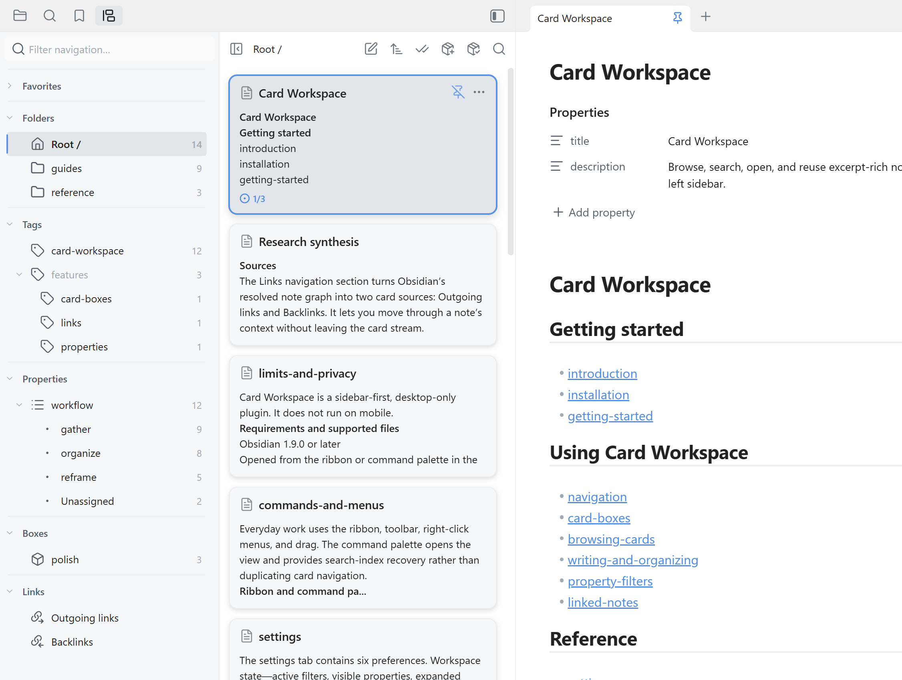

# Card Workspace

[English](README.md)

Card Workspace 是一款支持**输入、汇集、整理、重构**的 [Obsidian](https://obsidian.md/) 插件。用快速输入或模板记下想法，再把文件夹、标签、属性、出链、反链与卡片盒汇集成可读的卡片流。桌面端运行在编辑器旁的**左侧边栏**，手机和平板则在主工作区打开。

每张 Markdown 卡片都有标题和轻量正文预览，不必把一组笔记压缩成一串文件名。点击卡片即可打开笔记。卡片盒把笔记汇集在一起，源文件仍留在原来的文件夹；把卡片拖到导航条目上，还可以移动文件、设置标签或属性、加入卡片盒。

使用文档：[card-workspace](https://kenanlian.github.io/card-workspace/zh/)。




## 目录

- [为什么选择 Card Workspace](#为什么选择-card-workspace)
- [安装](#安装)
- [文件类型](#文件类型)
- [快速开始](#快速开始)
- [功能特性](#功能特性)
- [兼容性与限制](#兼容性与限制)
- [隐私](#隐私)
- [开发](#开发)
- [发布](#发布)
- [支持与许可证](#支持与许可证)

## 为什么选择 Card Workspace

Card Workspace 适合一边写作、一边扫读和收集笔记的人：研究主题、长期项目、阅读清单，以及任何跨越文件夹的工作。它提供直接操作，不引入另一套查询语言。

- **输入** — 用快速输入随手记录想法，创建带标签和属性的笔记，或用模板处理重复记录。
- **汇集** — 浏览文件夹或卡片盒，用标签或 frontmatter 属性收窄卡片流；文件夹可按需包含子文件夹，也可以沿笔记的出链和反链寻找。
- **整理** — 排序、分组、置顶，再把有用的视角保存成卡片盒。
- **重构** — 在编辑器旁打开上下文，或把 Markdown 卡片拖入正在写的笔记。

## 安装

Card Workspace 可以从 Obsidian 第三方插件市场安装，也可以从 GitHub Releases 手动安装某个特定版本。

### 从插件市场安装

1. 打开 Obsidian 的 **设置 → 第三方插件**。
2. 如已开启安全模式，请先关闭。
3. 点击 **浏览**，搜索 **Card Workspace**。
4. 依次点击 **安装** 和 **启用**。

插件的[市场页面](https://community.obsidian.md/plugins/card-workspace)也可以把安装操作交回 Obsidian。

### 从 GitHub Releases 安装

需要使用当前市场版本以外的版本时，采用这种方式。

1. 从 [Releases](https://github.com/kenanlian/obsidian-card-workspace/releases) 页面下载对应版本。
2. 解压 `main.js`、`manifest.json` 和 `styles.css`，复制到仓库目录 `.obsidian/plugins/card-workspace/` 中。
3. 打开 **设置 → 第三方插件**。
4. 如有需要，关闭安全模式。
5. 在已安装插件列表中启用 **Card Workspace**。

## 文件类型

在设置中选择“仅文档”“常规格式”（默认）或“全部格式”。图片文件可显示缓存缩略图，非 Markdown 文件按标题搜索。详见[文件类型](docs/file-types.md)。

## 快速开始

1. 点击 ribbon 图标，或从命令面板运行 **打开 Card Workspace 视图**。桌面端在**左侧边栏**打开，移动端在主工作区打开。
2. 点击“新建笔记”、选择模板，或点击纸飞机按钮（“打开快速输入”）记下想法。快速输入在桌面端使用独立窗口，在移动端使用弹窗。
3. 在导航栏中选择文件夹或卡片盒，再用标签或属性值继续收窄；也可以从正在阅读的笔记进入它的出链或反链。
4. 浏览卡片流；用搜索、排序、分组或置顶整理视角，再点击卡片打开笔记。
5. 右键导航条目或卡片可使用更多操作。把 Markdown 卡片拖入已打开的编辑器，可以插入链接或内容；移动端使用卡片菜单中的插入和复制操作。

Card Workspace 会恢复上次浏览的**文件夹**；如果是库根目录，则恢复整个仓库。它不会重新打开上次的卡片盒或双链来源。

## 功能特性

- **快速输入。** 桌面端使用默认置顶的独立窗口，可配置全局快捷键，从其他软件随时唤起。选择保存文件夹，按需添加标题、标签和属性，并把笔记加入多个卡片盒。支持的 frontmatter 使用 Obsidian 原生属性编辑器。可以新建笔记，也可以把正文追加到已有笔记，Ctrl/Cmd+Enter 即可发送。手机和平板使用 Obsidian 弹窗。详见[笔记创建、模板与快速输入](docs/note-input.md)。
- **新建笔记与模板。** 在当前文件夹创建笔记，继承选中的标签或受支持的属性筛选；从卡片盒新建时，也会把笔记加入该盒子。导航中可保存常用模板，每个模板独立设置目标文件夹和日期／时间格式，支持 `{{date}}`、`{{time}}` 及行内格式覆盖。既能用模板新建笔记，也能把模板正文插入同名已有笔记。
- **导航栏。** 卡片流旁边是一栏宽度可调的导航栏，文件夹、标签、属性、卡片盒和收藏都只需一次点击。可以拖动分隔条调整宽度，或把导航栏收起来，让卡片占满整个宽度。当侧边栏宽度不足以容纳两栏时，布局会自动降为单栏，标题栏的切换按钮会在导航栏和卡片流之间切换。
- **导航控制。** 独立搜索导航条目，不影响卡片正文搜索。顶部按钮一键展开或折叠全部分区，也可以通过右键菜单展开或折叠文件夹、标签树。
- **隐藏导航条目。** 右键文件夹、标签或分区标题可隐藏条目。在 **设置 → Card Workspace → 导航** 中恢复分区，或管理全库隐藏的文件夹和标签。隐藏仅影响导航展示，卡片、搜索、筛选和已有收藏仍可使用。详见[导航隐藏说明](docs/navigation-visibility.md)。
- **文件夹与卡片盒筛选。** 选择文件夹并按需包含子文件夹，或打开卡片盒，再用标签或 frontmatter 属性收窄卡片流。标签与属性浏览筛选互斥，切换来源保留条件；筛选卡片盒不改变盒子规则、成员关系或成员计数。进入双链视图时暂停浏览筛选并显示提示。清除浏览筛选时，搜索词仍会保留。
- **卡片盒。** 把当前的文件夹、标签和属性视角连同分组配置保存成可复用的集合，它会持续收集符合规则的笔记。也可以手动加入或排除单篇笔记，并为每个盒子保留独立的排序、分组和置顶。在卡片盒配置窗口中可调整分组依据、属性字段、组排序依据和方向。源文件仍留在原处。双链视图可以保存为固定快照。
- **双链。** 围绕当前笔记切换出链与反链。可以跟随编辑器，也可以固定来源后继续查看其他笔记。 出链、反链默认按引用次数从多到少排序，并分别记住排序方式。每个文件保留一张卡片，徽标显示当前笔记与该文件之间的引用次数；反链默认显示 3 个引用上下文，可在设置中选择 1、2、3 或全部，并在卡片内展开其余片段。同段重复引用合并展示，次数仍按实际引用统计。出链和反链沿用普通卡片的正文渲染。出链的标题或块链接显示目标位置的内容，普通链接显示目标笔记的开头部分，并使用普通预览的行数设置；反链显示源笔记中的引用上下文。相同目标位置的重复引用合并展示。点击片段定位它展示的源引用处或目标位置。
- **本地全文搜索。** 在当前文件夹、卡片盒、出链或反链中搜索，支持连续中文和中英文混合查询。Markdown 卡片按原文顺序显示高亮命中片段，每段占两行，可通过独立设置选择每张卡片最多显示 1–5 段（默认 2 段），不受普通预览行数限制；重叠上下文合并，较短的命中行补充后续连续正文。点击片段或按 Enter/空格可定位命中，并保留笔记的编辑或阅读模式。命中数徽标仍保留，仅标题命中时高亮标题并保留普通开头预览；清空搜索恢复普通预览。
- **整理卡片流。** 按编辑时间、创建时间或文件名排序，并对卡片分组。置顶让需要的笔记留在顶部；置顶只重排已经符合当前筛选和搜索的卡片。
- **拖入编辑器。** 把 Markdown 卡片拖到光标处，可插入 wikilink、嵌入、正文，或「标题 + 正文」。既可以每次选择，也可以设置默认方式。在行为设置中打开默认关闭的「启用章节拖拽插入」，即可选择标题章节或整篇笔记。章节内容包含下级标题，截止到下一个同级或更高级标题；复制保留原始 Markdown 格式。
- **拖入画布。** 把卡片作为 Obsidian 原生文件拖入 Canvas 或 Excalidraw，由目标决定展示方式并处理修饰键。即使处于批量模式，一次拖拽也只包含起拖的那张卡片。
- **拖放整理。** 把卡片拖到文件夹以移动文件，拖到标签以添加标签，拖到属性值以设置或追加属性，拖到卡片盒以手动入盒。拖动已选中的卡片可对当前可见选区批量执行。触屏长按开始拖拽，单栏布局会自动打开导航弹窗作为投放目标。
- **自定义内容图标。** 点击导航或卡片标题图标，或使用右键菜单，选择 Lucide 图标、原生 emoji 或无图标（纯文字）。设置中可调整各类别的默认图标，收藏跟随源对象；选择后自动保存并关闭选择器，最近使用和分类推荐优先显示，完整中英文 emoji 目录离线可用。详见[自定义图标](docs/content-icons.md)。
- **外观与紧凑程度。** 在“外观”设置中缩放面板文字（小、默认、大、特大），选择紧凑、默认或宽松的间距，调整圆角与预览长度，并选择卡片样式：默认卡片、极简边框、以分隔线区分的列表、扁平色块或左侧强调条。同一行的列表卡片等高，多列时分隔线保持对齐。可设置默认卡片背景颜色，也可通过卡片右键菜单或批量工具栏的“背景颜色”选择八种随主题适配的底色。“跟随默认”可清除单卡颜色设置。
- **卡片图片预览。** 从 1.3.4 起，默认使用右侧缩略图并裁切铺满。可在插件设置中切换为标题下方内联图片、选择完整显示，或关闭图片预览。正文中的本地 PNG、JPEG、WebP、BMP 图片在浏览区域附近按需加载，缩略图跨重启缓存。详见[图片预览说明](docs/card-images.md)。
- **批量操作。** 点击选择单张卡片，Shift+点击连续选择，或全选当前视角。随后可移动笔记、添加或移除标签、加入或移出卡片盒、通过实时预览合并 Markdown 笔记，或删除所选内容。
- **文件夹拖放。** 在“文件夹”分区内，拖到目标行中间一半可移入该目录；拖到上、下各四分之一可排在目标前、后，仅允许同级排序。松手后直接执行。悬停 600ms 会临时展开折叠目标，靠近滚动边缘会自动滚动。根目录固定首位，只接受移入。首次有效排序后，该组兄弟目录保存独立手动顺序，新建或移入的目录追加到末尾。文件夹右键菜单在独立分组中提供子文件夹名称排序（A → Z、Z → A）和手动排序，仅排序该文件夹的直接子文件夹，顶层排序入口也位于“文件夹”分区和根目录的右键菜单。A → Z 清除该层手动顺序，恢复默认名称排序；Z → A 保存当前倒序，之后新增目录仍追加到末尾。菜单勾选当前排序模式，选择手动排序会保留当前顺序，完成有效的拖拽排序后自动勾选手动排序。同名冲突不会合并或覆盖。文件夹与收藏拖放各自在自己的分区内生效。
- **标签和属性导航排序。** 右键“标签”或“属性”分区，可选择名称升序、名称降序或手动排序；父标签菜单排序直接子标签，属性名菜单排序该属性的值。同级条目拖到目标行上半或下半，可放在其前或后，并自动切换为手动排序。拖拽只改变显示顺序，支持边缘自动滚动。顺序在所有视图间共享，重启后保留。新增条目在名称模式下自动参与排序，在手动模式下追加到末尾；暂时消失的属性值保留原来的手动位置。“未分配”固定末尾，不参与拖拽。通过插件重命名标签时，会同步更新排序记录。
- **收藏。** 可把常用的文件夹、文件、标签和卡片盒放进同一区域，不同类型可混排，顺序由拖拽决定。
- **右键菜单。** 在导航栏或卡片上右键即可新建笔记、文件夹、白板和 Base，重命名、复制、移动、删除，复制仓库路径或系统路径，在系统文件管理器中定位，以及在指定文件夹内搜索。确认后重命名或删除标签时，会同步更新笔记、当前筛选、收藏和卡片盒规则。
- **按习惯预览或打开。** 可以悬停预览笔记，也可以在当前标签页、新标签页、分栏或新窗口中打开。启用核心插件“页面预览”后，可在本插件的“外观”设置中调整卡片悬浮预览的宽高（默认 600 × 400 像素），弹窗会随窗口大小收缩。点击卡片打开笔记；在编辑器中切换笔记时，对应卡片也会被选中。
- **虚拟化滚动。** 只渲染当前可见的卡片，大型来源依然可以扫读。
- **移动端工作区。** 手机使用单列卡片和导航弹窗，平板按可用宽度切换布局。点击菜单按钮操作卡片，插入或复制卡片内容，并使用 Obsidian 的返回控件浏览范围历史。外观和工作区偏好保存在各设备本地，卡片盒、收藏、置顶与模板则可随仓库同步。详见[移动端说明](docs/mobile.md)。

## 兼容性与限制

- **支持桌面和移动端。** 手机使用主工作区页面与导航面板，平板按容器宽度切换布局。设备设置归属与待完成的真机验收见[移动端说明](docs/mobile.md)。
- **打开位置。** 从 ribbon 图标或命令面板打开，桌面端位于左侧边栏，移动端位于主工作区。
- **桌面快速输入。** 需要在 Obsidian“外观”设置中使用“Obsidian 窗口边框”或“隐藏窗口边框”，修改后完整重启。草稿只保存在内存中，不跨重启保留。平台能力要求和验收情况见[快速输入说明](docs/note-input.md)。
- **Obsidian 版本要求。** 需要 Obsidian 1.11.4 或更高版本。1.13 及以上使用原生确认弹窗、声明式设置并接入设置搜索；1.11.4–1.12 使用兼容弹窗和共用定义的旧版设置渲染入口。实际行为和兼容性以 `manifest.json` 为准。更早的 Obsidian 版本会继续收到最后一个兼容的发行版（1.3.4）。
- **受支持的文件。** Markdown（`.md`）卡片有完整预览和全文索引。Bases（`.base`）使用标题和占位内容。Canvas（`.canvas`）显示包含节点、连线和标签的缩略图；Excalidraw（`.excalidraw` 与 `.excalidraw.md`）显示同目录导出的 SVG，请安装 Excalidraw 插件并开启 SVG 自动导出。这三类文件仍只按标题搜索。两类图形始终内联并完整显示，不受卡片图片设置控制。图片文件可显示缩略图，PDF、音频、视频和其他文件显示类型及文件信息，不提供正文预览或播放器。导航文件夹右键菜单支持新建 Excalidraw 文件。详见[文件类型](docs/file-types.md)和[图形预览限制与导出命名](docs/diagram-previews.md)。

## 隐私

所有处理都在你的本地仓库内完成。该插件不会发起外部网络请求。文件操作通过 Obsidian 本地的 Vault 和 FileManager API 完成。随插件打包的搜索引擎把本地索引存在 IndexedDB 中。笔记仍留在原有文件夹。

## 开发

```bash
npm install
npm run build
```

如需启用 watch 模式：

```bash
npm run dev
```

运行类型检查和测试：

```bash
npm run check
npm test
```

## 发布

此仓库通过 `.github/workflows/release.yml`，基于纯 semver 标签自动创建 GitHub Release。

1. 从 `manifest.json` 中确定目标版本：

   ```bash
   TAG=$(node -p "require('./manifest.json').version")
   ```

2. 同步发布元数据：

   ```bash
   npm run release:prepare -- "$TAG"
   ```

   如果还需要同时调整最低支持的 Obsidian 版本，可将它作为第二个参数传入：

   ```bash
   npm run release:prepare -- "$TAG" 1.11.4
   ```

3. 运行常规检查以及发布校验：

   ```bash
   npm run check:svelte
   npm run check
   npm run build
   npm test
   npm run release:check -- "$TAG"
   ```

4. 提交版本变更，然后创建并推送一个带注释的纯 semver 标签，该标签必须与 `manifest.json.version` 完全一致（例如 `<version>`，而不是 `v<version>`）：

   ```bash
   git tag -a "$TAG" -m "$TAG"
   git push origin main
   git push origin "$TAG"
   ```

5. 工作流会创建一个包含 `main.js`、`manifest.json`、`styles.css`、`LICENSE` 和 `THIRD_PARTY_NOTICES` 的 GitHub Release。发布说明会附上对应版本的源码归档和构建说明链接。
6. 在 GitHub 上检查并补充发布说明。

## 支持与许可证

如果你遇到问题，请前往 [GitHub Issues](https://github.com/kenanlian/obsidian-card-workspace/issues) 提交 issue。

Copyright (c) 2026 kenanlian.

除另有声明外，Card Workspace 本次修订及后续版本中由项目拥有版权的文件采用 **GNU General Public License 第 3 版，仅限该版本**（`GPL-3.0-only`）。完整条款见 [LICENSE](LICENSE)。你可以按该协议重新分发和修改软件；软件不提供任何担保，包括适销性或特定用途适用性的默示担保。

此前已经发布的 **1.4.2 及更早版本**继续适用其发布时的 MIT License，参见 [1.4.2 的许可证](https://github.com/kenanlian/obsidian-card-workspace/blob/1.4.2/LICENSE)。本次变更不撤销此前授予的权限。

打包的第三方库保留各自原有的许可证和版权声明，见 [THIRD_PARTY_NOTICES](THIRD_PARTY_NOTICES)。每个 Release 都提供对应版本的源码归档；构建说明见[开发](#开发)。
